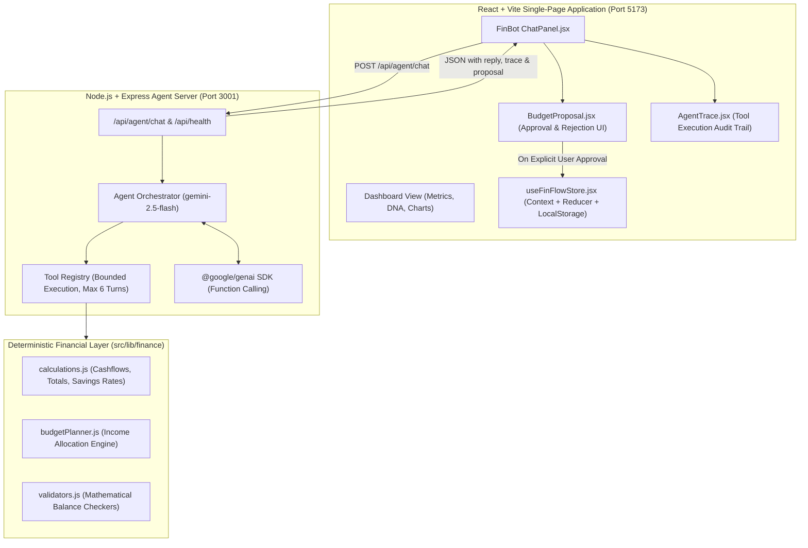

# 💎 FinFlow AI Copilot — Agentic Financial Intelligence

**FinFlow** is an agentic personal finance platform that combines a **React 19 + Vite** dashboard with an autonomous **AI Financial Copilot** powered by **Google Gemini 2.5 Flash** and an Express orchestration backend.

Rather than only answering generic questions, FinFlow's AI Copilot plans, invokes deterministic financial tools, checks calculations mathematically, requests explicit user approval, and executes verified changes into your local ledger.

---

## 🏛️ System Architecture



---

## 🚀 Key Agentic Capabilities

1. **Financial Analyst Agent**: Analyzes income, expenses, category breakdowns, and savings velocity using real transaction records.
2. **Budget Planner Agent**: Generates category budgets based on actual spending habits while strictly safeguarding user savings targets.
3. **Tool-Calling Orchestration**: Gemini dynamically selects from a registered set of tools:
   - `get_financial_summary`: Retrieves income, expenses, net savings, and savings rate.
   - `get_category_spending`: Ranks and groups expense totals by category.
   - `get_monthly_summary`: Filters cashflow for a specific month (`YYYY-MM`).
   - `propose_budget`: Calculates category allocations using historical weights.
   - `validate_budget`: Rigorously verifies arithmetic balance before presentation.
   - `get_existing_budgets`: Reads current user limits.
4. **Explicit Human-in-the-Loop Approval**: The agent **never** autonomously mutates stored finances. Proposed plans must be reviewed, confirmed, and verified by the user in the UI.
5. **Agent Audit Trail (Trace)**: A collapsible execution log showing which tools were called, their status, and execution summaries.
6. **Robust Offline Fallback**: If the backend or AI provider is unreachable, FinFlow automatically falls back to its built-in local deterministic rule engine.

---

## 🛠️ Technology Stack

- **Frontend Core**: React 19, Vite, Lucide Icons, Vanilla CSS Design System
- **Backend API**: Node.js, Express, CORS, Dotenv, Zod
- **Agent Framework**: Google Gemini 2.5 Flash via `@google/genai` Function Calling
- **Data Visualizations**: Chart.js, React-ChartJS-2, Generative Polar SVG Bézier Math
- **Testing**: Node.js built-in test runner (`node --test`)
- **Persistence**: Browser `localStorage` (Offline-first architecture)

---

## 📦 Setup & Operations

### 1️⃣ Clone & Install

```bash
# Clone repository
git clone https://github.com/Aj1359/Finflow-Transactions.git
cd Finflow-Transactions

# Install frontend dependencies
npm install

# Install backend dependencies
cd server
npm install
cd ..
```

### 2️⃣ Configure Environment Variables

**Backend (`server/.env`):**
```env
GEMINI_API_KEY=your_gemini_api_key_here
PORT=3001
CLIENT_ORIGIN=http://localhost:5173
```
> *Security Note:* The Gemini API key remains strictly on the backend and is never bundled into client-side code.

**Frontend (`.env` - Optional for local dev):**
```env
VITE_API_BASE_URL=http://localhost:3001
```

### 3️⃣ Run Applications

**Terminal 1 — Backend Agent API:**
```bash
cd server
npm run dev
# Server runs on http://localhost:3001 (Health check: http://localhost:3001/api/health)
```

**Terminal 2 — Frontend Dashboard:**
```bash
npm run dev
# Dashboard runs on http://localhost:5173
```

---

## 🧪 Running Tests

FinFlow includes a deterministic test suite verifying mathematical consistency, budgeting arithmetic, and parameter validations:

```bash
# Run financial test suite
npm run test:finance
```

---

## 🌐 Deployment Guide

- **Frontend**: Deploy to **Vercel** or **Netlify** using repository root settings (`Build command: npm run build`, `Output: dist`). Set `VITE_API_BASE_URL` to your production backend URL.
- **Backend**: Deploy the `server/` directory to **Railway**, **Render**, or **Fly.io**. Set `GEMINI_API_KEY`, `CLIENT_ORIGIN`, and `PORT` in the hosting environment variables.
- **Prototype Limitation**: Browser `localStorage` stores transaction records on the client device. This prototype demonstrates agentic workflows without requiring multi-tenant cloud database configuration.

---

## 👤 Developer
**Aditya Jha**  
*Builder | Strategic Financial Systems*