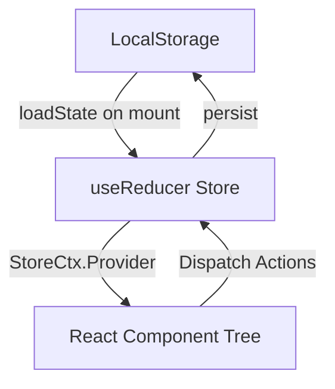

# 🎯 FinFlow Project Audit & Brutal Technical Interview Masterclass

---

## 1. 🚀 Operations & How to Run (Commands, Ports & Scripts)

### **Scripts in `package.json`**
```json
"scripts": {
  "dev": "vite",
  "build": "vite build",
  "lint": "eslint .",
  "preview": "vite preview"
}
```

### **1. Install Dependencies**
```bash
npm install
```

### **2. Development Server**
* **Default Command:** `npm run dev`
* **Default Port:** `http://localhost:5173`
* **Run on a Custom Port (e.g., 3000):**
  ```bash
  npm run dev -- --port 3000
  ```
* **Expose to Local Network (Host flag):**
  ```bash
  npm run dev -- --host
  ```

### **3. Production Build & Preview**
* **Build Bundle:** `npm run build` *(Outputs optimized static files to `/dist`)*
* **Preview Production Build:** `npm run preview` *(Default preview port: `http://localhost:4173`)*
* **Run Preview on Custom Port:** `npm run preview -- --port 8080`

### **4. Environment Variables**
* File: `.env`
* Variable: `VITE_GEMINI_API_KEY`
* Usage: Accesses Google Gemini 1.5 Flash model for AI-powered chat assistance inside `src/lib/chatbot.js`.

---

## 2. 💾 Complete LocalStorage Persistence Architecture

The application uses **Browser LocalStorage** as a synchronous offline database layer. State is initialized lazily and persisted across user interactions inside `src/store/useFinFlowStore.jsx` and `src/components/chatbot/ChatPanel.jsx`.

### **Key Schema (`LS_KEYS` in `src/lib/constants.js`)**

| Storage Key | Constant Name | Type | Fallback Value if Empty | Purpose |
| :--- | :--- | :--- | :--- | :--- |
| `finflow_transactions` | `LS_KEYS.TX` | `JSON Array` | `[...SEED_DATA]` (34 transactions) | Stores all income and expense records |
| `finflow_role` | `LS_KEYS.ROLE` | `String` | `'admin'` | Current user permission level (`'admin'` \| `'viewer'`) |
| `finflow_theme` | `LS_KEYS.THEME` | `String` | `'light'` | UI theme attribute (`'light'` \| `'dark'`) |
| `finflow_budgets` | `LS_KEYS.BUDGETS` | `JSON Object` | `{}` | Monthly expenditure limit allocation per category |
| `finflow_chat_history` | Hardcoded | `JSON Array` | `[]` (resets to welcome prompt) | Chat transcript history between user & FinBot |

### **How Persistence Works Under the Hood**
1. **Lazy Initialization (`loadState()`):**
   Passed as the 3rd argument to React's `useReducer(reducer, undefined, loadState)`. Executes **once on initial mount** to parse JSON from LocalStorage without blocking re-renders.
2. **Synchronous Write-Through (`persist(nextState)`):**
   Every mutating action (`ADD_TX`, `DELETE_TX`, `SET_ROLE`, `SET_THEME`, `SET_BUDGET`) triggers `persist(next)` inside the reducer **before returning the state to React**.

---

## 3. 🧠 State Management & Data Flow Architecture

The app uses a **Centralized Context + Reducer Pattern** (Zustand/Redux alternative built with native React APIs).



### **State Store Actions (`reducer`)**
* `ADD_TX`: Prepends a new transaction object. Checks balance & budget limits.
* `DELETE_TX`: Filters out transaction by `id`. (Restricted to `admin` role).
* `RESET_TX`: Reverts transactions array back to default `SEED_DATA`.
* `SET_ROLE`: Toggles between `'admin'` (full privileges) and `'viewer'` (read-only UI).
* `SET_THEME`: Updates `'data-theme'` attribute on `document.documentElement` and state.
* `SET_BUDGET`: Updates target category budget limit object `{ [category]: amount }`.
* `NAVIGATE`: Changes `activeSection` (`'dashboard'`, `'transactions'`, `'insights'`, `'budget'`).
* `SET_SORT` & `SET_FILTER`: Handles grid sorting parameters (`key`, `dir`) and filtering criteria (`search`, `filterType`, `filterCat`, `filterMonth`).

---

## 4. 🧱 Comprehensive Component-by-Component Deep Dive

### **Application Entry & Shell**
* **`src/main.jsx`:** Mounts React root inside `<StrictMode>`, wraps app in `<FinFlowProvider>` and attaches global configuration `window.FINFLOW_CONFIG`.
* **`src/App.jsx`:** Top-level gatekeeper. Displays `LandingPage` until user enters, then renders `AppLayout` with `Toast` provider.
* **`src/components/layout/AppLayout.jsx`:** App scaffold. Manages responsive drawer overlays, header, sidebar, and floating AI chat panel state.
* **`src/components/layout/Header.jsx`:** Displays dynamic page headers based on `activeSection`, theme switcher (Sun/Moon), and role dropdown (`Admin` / `Viewer`).
* **`src/components/layout/Sidebar.jsx`:** Navigation sidebar with section links, AI Assistant trigger button, and status indicators.

---

### **Pages & Visualizations**
* **`src/pages/LandingPage.jsx`:** Premium landing hero featuring CSS 3D grid animations, floating spheres, and direct entry cards for Admin and Viewer roles.
* **`src/pages/DashboardPage.jsx`:** Central dashboard combining summary cards, spending gauge, charts, and recent transaction feeds.
* **`src/pages/TransactionsPage.jsx`:** Ledger page featuring real-time searching, category/month filtering, transaction creation modal, and CSV/JSON export utility.
* **`src/pages/InsightsPage.jsx`:** Analytics view featuring savings rate metrics, month-over-month comparisons, category breakdown bars, and risk alerts.
* **`src/pages/BudgetPage.jsx`:** Budget allocation dashboard displaying live category progress bars, remaining liquidity calculation, and inline budget limit editing for admins.

---

### **Dashboard & Analytical Components**
* **`src/components/dashboard/SummaryCards.jsx`:** Displays Net Balance, Total Income, and Total Expenses with animated counter interpolation (`requestAnimationFrame`).
* **`src/components/dashboard/SpendingGauge.jsx`:** Dynamic SVG semi-circle gauge rendering expense-to-income percentage with color-coded risk levels (*Healthy* `<50%`, *Caution* `50-75%`, *High Risk* `>75%`).
* **`src/components/dashboard/CategoryBars.jsx`:** Accordion category expenditure list with Lucide icons, percentage contribution calculation, and CSS fill animations.
* **`src/components/dashboard/RecentTransactions.jsx`:** Compact list showing the top 5 most recent transactions with status indicators.

---

### **Charts (Chart.js Integration)**
* **`src/components/charts/TrendChart.jsx`:** Canvas bar chart displaying 6-month financial momentum (Income vs. Expenses) with dual linear color gradients.
* **`src/components/charts/DonutChart.jsx`:** Interactive doughnut chart rendering spending per expense category with dynamic theme color mapping.
* **`src/components/charts/MonthlyChart.jsx`:** Historical 4-month comparison bar chart with formatted currency tooltips.

---

### **Transactions & Modals**
* **`src/components/transactions/TransactionTable.jsx`:** Multi-column transaction grid supporting client-side sorting, text search, date filtering, mobile responsive card fallback, and admin deletion controls.
* **`src/components/transactions/AddTransactionModal.jsx`:** Form modal for adding transactions. Validates inputs, blocks expenses exceeding current balance, and prompts confirmation alerts if an expense breaches budget limits.

---

### **AI Assistant & Utilities**
* **`src/components/chatbot/ChatBubble.jsx`:** Pulsing glassmorphic chat widget button with unread message badge.
* **`src/components/chatbot/ChatPanel.jsx`:** Floating AI chat interface. Renders Markdown-formatted responses, supports quick suggestion chips, handles warning prompts, and invokes state modifications.
* **`src/lib/chatbot.js`:** **FinBot AI Engine**:
  1. **Regex Intent Classifier:** Parses user prompts for intents (`add_transaction`, `set_budget`, `balance`, `top_spend`, `forecast`, `search`).
  2. **Offline RAG Engine (`ragResponse`):** Generates financial reports dynamically using local state when offline or unconfigured.
  3. **Gemini 1.5 Flash API:** Calls Google Gemini REST endpoint with structured financial context payloads and system prompts when `VITE_GEMINI_API_KEY` is present.
* **`src/lib/utils.js`:** Helper module providing `fmt` (Indian Rupee formatting via `Intl.NumberFormat`), `fmtShort` (`₹1.5L`, `₹2.3K`), `computeTotals`, date utilities, and blob export downloading.
* **`src/hooks/useToast.js`:** Custom React hook managing toast queues with automatic 3.8-second dismissal.

---

## 5. 🔥 Brutal Technical Interview Grilling (Staff/Principal Level)

*Imagine sitting across from a Senior Staff Engineer or Engineering Director. Here are the tough questions they will ask about this codebase, along with the expected high-bar answers.*

---

### **Q1: "Your `useReducer` executes `persist(next)` synchronously inside the reducer function. What critical React principle does this violate, and how could it break under Concurrent React?"**
> **Brutal Truth:** Reducer functions in React are required to be **pure functions** with zero side effects. Calling `localStorage.setItem()` inside a reducer is an anti-pattern.
>
> **Staff Engineer Answer:** 
> *"Putting side effects like `localStorage.setItem` inside the reducer breaks purity. In React 18+ Concurrent Mode, React may invoke reducers multiple times speculatively or discard render passes during transition updates. This can cause redundant, stale, or out-of-order writes to LocalStorage.*
>
> *To fix this, the reducer should strictly compute the next state. Side effects should be decoupled into a dedicated `useEffect` hook observing state changes, or via custom middleware using a state subscriber mechanism."*

---

### **Q2: "Your `loadState()` function reads synchronous LocalStorage data on the main thread during initial state instantiation. Why is this dangerous for performance?"**
> **Staff Engineer Answer:**
> *"LocalStorage access is synchronous and blocks the Main Thread I/O. If the user's dataset grows to thousands of records, parsing a massive JSON string during initial render can cause long tasks, triggering frame drops, input latency, and poor Interaction to Next Paint (INP) scores.*
>
> *The proper fix is to migrate high-volume data to **IndexedDB** using `idb` or `localForage`, which provides an asynchronous, non-blocking storage API using Web Workers or promises."*

---

### **Q3: "I noticed `window.FINFLOW_CONFIG` exposes the Gemini API Key globally in the DOM. How severe is this security vulnerability?"**
> **Staff Engineer Answer:**
> *"Exposing `VITE_GEMINI_API_KEY` on `window.FINFLOW_CONFIG` and baking static keys into frontend bundles is a critical security vulnerability. Anyone opening Chrome DevTools or inspecting client memory can steal the API key and drain usage quotas.*
>
> *In production, **API keys should never exist in client-side code**. All AI requests must route through a secure Backend API gateway or Serverless Cloud Function (e.g., AWS Lambda, Node/Express proxy) that authenticates the user session, enforces rate-limiting, and securely passes secrets to Google APIs server-to-server."*

---

### **Q4: "In `MonthlyChart.jsx`, `TrendChart.jsx`, and `DonutChart.jsx`, you destroy and recreate Chart.js instances inside a `useEffect` on every render. Why is this inefficient?"**
> **Staff Engineer Answer:**
> *"Completely destroying and re-instantiating the `Chart` instance on every state change causes unnecessary DOM operations, layout recalcs, and canvas context recreations. It also ruins smooth transition animations when filters change.*
>
> *Instead of calling `chart.destroy()` and `new Chart()`, we should retain the chart instance reference in a `useRef` and perform incremental updates via `chart.data = newData; chart.update('active');`."*

---

### **Q5: "How does your app handle data synchronization across multiple browser tabs?"**
> **Staff Engineer Answer:**
> *"Currently, if a user opens FinFlow in two tabs and adds a transaction in Tab A, Tab B will become stale because state is held in React component memory.*
>
> *To solve cross-tab sync, we can attach a window listener to the native `'storage'` event (`window.addEventListener('storage', ...)`). When Tab A mutates LocalStorage, Tab B's listener fires, allowing us to dispatch a `SYNC_STATE` action to instantly refresh Tab B's reducer state without a page reload."*

---

### **Q6: "Your search filter in `TransactionTable.jsx` runs directly on every keystroke in the render body. What happens when the dataset reaches 50,000 transactions?"**
> **Staff Engineer Answer:**
> *"Filtering array elements directly in the component render path runs an $O(N)$ operation on every render pass. With 50,000 transactions, filtering on every character typed will block the main thread and cause visible typing lag.*
>
> *We should optimize this using two techniques:*
> 1. *Wrap the filtering and sorting calculations in `useMemo()` with `[transactions, search, filterType, filterCat, filterMonth, sortKey, sortDir]` dependencies.*
> 2. *Debounce the search input handler using a 200ms-300ms debounce function or React 18's `useDeferredValue(search)` hook so filtering only executes after typing pauses."*

---

### **Q7: "Explain how your Chatbot Fallback Engine works when there is no internet connection."**
> **Staff Engineer Answer:**
> *"FinBot uses a **Hybrid Architecture** combining an offline Rule-Based Intent Classifier with an Online Gemini 1.5 Flash LLM Fallback:*
> 1. *When offline or when no API key exists, `detectIntent()` runs regex rules against the user prompt to extract intents, amounts, and categories.*
> 2. *The offline RAG engine (`ragResponse`) calculates exact numbers from local state (`totalIncome`, `totalExpense`, `savingsRate`) and constructs deterministic markdown responses.*
> 3. *If a Gemini API key is configured and reachable, `callGemini()` sends structured financial context to the LLM, prompting it to return conversational responses or structured JSON action payloads (`add_transaction`, `set_budget`, `delete_transaction`) parsed by `parseAction()`."*

---

### **Q8: "Your application uses custom Context (`StoreCtx`). Why might this cause unnecessary re-renders across un-related components?"**
> **Staff Engineer Answer:**
> *"React Context passes a single context value object containing both state and dispatch handlers. Whenever any property in state updates (e.g., typing in search), **every component consuming `useStore()` will re-render**, even if it only cares about `theme` or `role`.*
>
> *To prevent re-render cascades, we can split Context into separate `StateContext` and `DispatchContext`, or migrate to lightweight atomic state tools like **Zustand** or **Jotai**, which support fine-grained selector subscriptions (e.g., `useStore(state => state.role)`)."*

---

### **Q9: "How are currency values formatted throughout the application, and why is `Intl.NumberFormat` preferred over raw string manipulation?"**
> **Staff Engineer Answer:**
> *"In `src/lib/utils.js`, we use ECMAScript's native `Intl.NumberFormat('en-IN', { style: 'currency', currency: 'INR' })`.*
>
> *This is far superior to regex or manual string formatting because `Intl.NumberFormat` natively respects regional number grouping rules (such as India's 2,00,000 Lakh system vs International 200,000 system), handles currency symbols correctly, and provides localized formatting performance optimized by browser JavaScript engines."*

---

### **Q10: "If you were asked to scale this project for enterprise deployment, what architectural upgrades would you propose?"**
> **Staff Engineer Answer:**
> *"For an enterprise-grade rollout, I would prioritize five key pillars:*
> 1. **Backend Integration:** Replace LocalStorage with a REST/GraphQL API backed by PostgreSQL and Prisma ORM for relational transaction integrity.
> 2. **Authentication & RBAC:** Implement OAuth 2.0 / OIDC with JWT token rotation to enforce server-side Role-Based Access Control (RBAC) instead of client-side dropdown switching.
> 3. **State Management:** Migrate to Zustand or TanStack Query (React Query) for server state caching, optimistic updates, and automatic retry logic.
> 4. **AI Gateway:** Move Gemini LLM invocation to a Node.js/Python serverless function with Redis rate-limiting and response sanitization.
> 5. **Testing Suite:** Add unit tests using Vitest/React Testing Library for financial calculation utilities and E2E automation tests using Playwright."*
