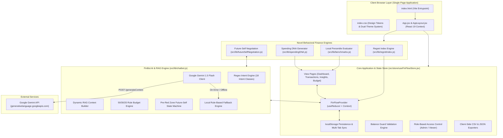
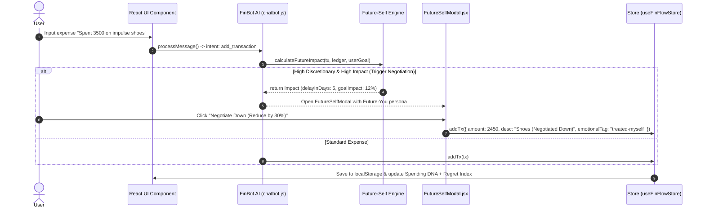

# 🏛️ FinFlow — Complete System Architecture & Module Specifications

This document provides a comprehensive technical breakdown of **FinFlow**, detailing the system architecture, directory structure, core modules, algorithms, data flows, tech stack, and feature specifications based strictly on the production React 19 + Vite codebase.

---

## 1. 📐 High-Level System Architecture



---

## 2. 🧰 Tech Stack Specification

| Category | Technology | Version / Specification | Purpose in FinFlow |
| :--- | :--- | :--- | :--- |
| **Frontend Core** | React | v19.2.4 (JSX) | Modern component architecture, state hooks, and context providers. |
| **Build Tooling** | Vite | v8.0.1 | Next-gen lightning-fast dev server and module bundler. |
| **Icons & UI** | Lucide React | v1.7.0 | Clean SVG icons for finance navigation, badges, and controls. |
| **Styling & Themes** | Vanilla CSS | CSS Custom Properties | Custom tokens, glassmorphism, responsive CSS grid, dark/light themes. |
| **Data Visualization** | Chart.js / react-chartjs-2 | v4.5.1 / v5.3.1 | Financial line charts, doughnut category charts, and monthly comparison bars. |
| **Generative Graphics**| Native SVG | Inline SVG Math | Custom semi-circular gauge meters & 8-axis bezier Spending DNA fingerprints. |
| **Client Storage** | `localStorage` API | Web Storage API | 100% offline persistence for transactions, budgets, roles, and themes. |
| **AI / LLM** | Google Gemini API | `gemini-1.5-flash` model | Natural language intent extraction, tone mining, and conversational guidance. |

---

## 3. 📂 Module & File Architecture

```
FinFlow/
├── index.html                  # Vite single-page HTML container
├── vite.config.js              # Vite configuration & dev server options
├── package.json                # Project dependencies & build scripts
├── system_architecture.md     # Complete system architecture documentation
├── src/
│   ├── main.jsx                # React app entry point
│   ├── App.jsx                 # Main layout & Toast provider wrapper
│   ├── index.css               # Design system variables & theme tokens
│   ├── store/
│   │   └── useFinFlowStore.jsx # Central state store & local storage persistence
│   ├── lib/
│   │   ├── chatbot.js          # FinBot NLP engine, intent parser, Gemini client & fallback
│   │   ├── regretIndex.js      # NLP tone mining & Regret Score calculator
│   │   ├── futureSelfNegotiation.js # Pre-red zone Future-Self persona negotiator
│   │   ├── spendingDNA.js      # Generative polar bezier SVG fingerprint math
│   │   ├── benchmarks.js       # Offline reference percentile dataset & benchmark evaluator
│   │   ├── constants.js        # Categories, seed data, and localStorage keys
│   │   └── utils.js            # Currency formatters & CSV/JSON export utilities
│   ├── components/
│   │   ├── dashboard/          # SummaryCards, SpendingGauge, SpendingDNA, CategoryBars
│   │   ├── insights/           # RegretIndexWidget, LocalBenchmarkWidget, InsightCards
│   │   ├── chatbot/            # ChatPanel, ChatBubble
│   │   ├── layout/             # AppLayout, Header, Sidebar
│   │   └── ui/                 # FutureSelfModal, Toast, Logo
│   └── pages/
│       ├── DashboardPage.jsx   # Business Intelligence & Spending DNA view
│       ├── TransactionsPage.jsx# Ledger view with filter, search & CSV export
│       ├── InsightsPage.jsx    # Behavioral intelligence & peer benchmark view
│       ├── BudgetPage.jsx      # 50/30/20 & category budget management
│       └── LandingPage.jsx     # Welcome splash screen
```

---

## 4. ⚙️ Detailed Module Breakdown & Core Novel Engines

### 4.1 Regret Index Engine (`src/lib/regretIndex.js`)
- **Tone Classification (`classifyTransactionTone`)**: Classifies transaction descriptions into 5 emotional registers (`impulse`, `stress-bought`, `treated-myself`, `necessary`, `planned`).
- **Score Calculation (`calculateRegretIndex`)**: Computes composite weighted scores ($0 - 100$) per transaction, category, and overall monthly spending.
- **UI Widget (`RegretIndexWidget.jsx`)**: Renders overall regret gauge, category regret heatmap, emotional register pill breakdown, and high-regret transaction flags.

### 4.2 Future-Self Negotiation Engine (`src/lib/futureSelfNegotiation.js`)
- **Savings Impact Calculation (`calculateFutureImpact`)**: Evaluates proposed expense against active user savings targets:
  $$\text{delayInDays} = \left\lceil \frac{\text{Amount}}{\text{Daily Net Savings Rate}} \right\rceil$$
- **Dialogue Generation (`generateFutureSelfDialogue`)**: Creates conversational pushback from "Future You" persona.
- **Interactive Modal (`FutureSelfModal.jsx`)**: Offers pre-transaction choices (*Negotiate Down*, *Wait 48h*, *Proceed with Reflection*).

### 4.3 Spending DNA Engine (`src/lib/spendingDNA.js`)
- **Vector Extractor (`generateSpendingDNAVectors`)**: Computes 8 financial habit vectors (Savings Velocity, Category Entropy, Volatility, Discretionary Ratio, Tx Frequency, Spike Magnitude, Impulse Factor, Health Index).
- **Polar Bezier Math (`buildDNAPath`)**: Converts vectors into smooth polar cubic bezier curves (`M...C...Z`).
- **Interactive Visualizer (`SpendingDNA.jsx`)**: Renders generative SVG art, node tooltips, MoM overlay comparison, and SVG export download.

### 4.4 Privacy-Preserving Local Benchmarking Engine (`src/lib/benchmarks.js`)
- **Offline Dataset (`BENCHMARK_DATASETS`)**: Static reference percentile statistics grouped by monthly income tiers (<₹30k, ₹30k-₹75k, >₹75k).
- **Percentile Evaluator (`evaluateLocalBenchmark`)**: Computes client-side percentile position without transmitting any user data.
- **UI Widget (`LocalBenchmarkWidget.jsx`)**: Renders radar comparisons and headline achievements (*"You spend less than 64% of similar earners on Dining Out"*).

---

## 5. 🛠️ Complete Pre-Red Zone Negotiation Data Flow



---

## 6. 🔒 Security, Validation & Resiliency Features

1. **100% Offline Privacy**: All peer benchmarks, Regret Index tone mining, and Spending DNA vectors execute client-side with zero data egress.
2. **Balance Guard**: Rejects any expense creation exceeding net available balance.
3. **Pre-Red Zone Negotiation**: Intercepts budget-risking discretionary purchases before commitment.
4. **Role-Based Access Control (RBAC)**: Protects administrative actions (`deleteTx`, clearing ledger) for `admin` role users.
5. **Multi-Tab Sync**: Keeps all browser windows synchronized in real-time via `StorageEvent` listeners.
